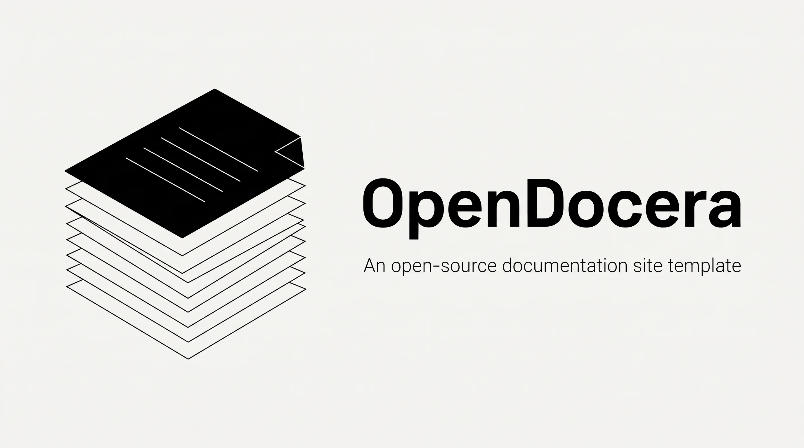
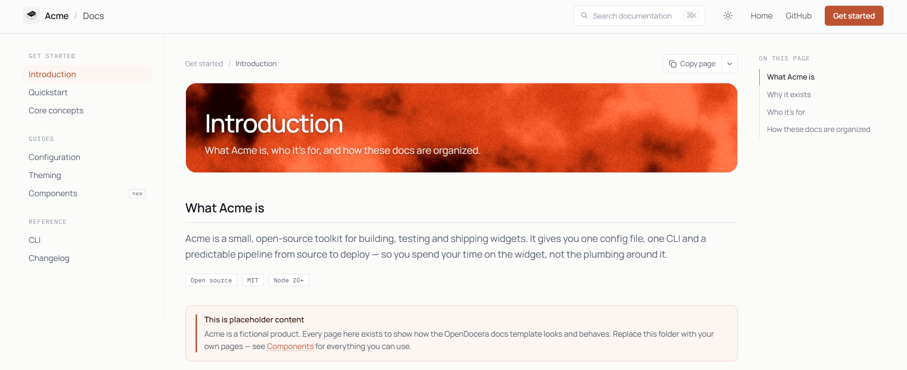
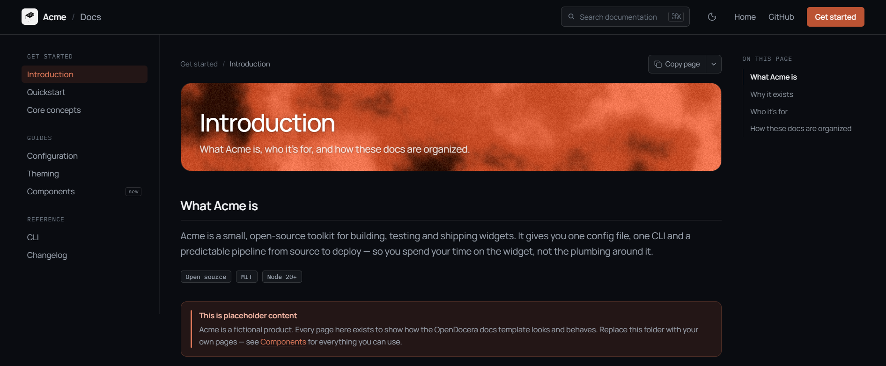
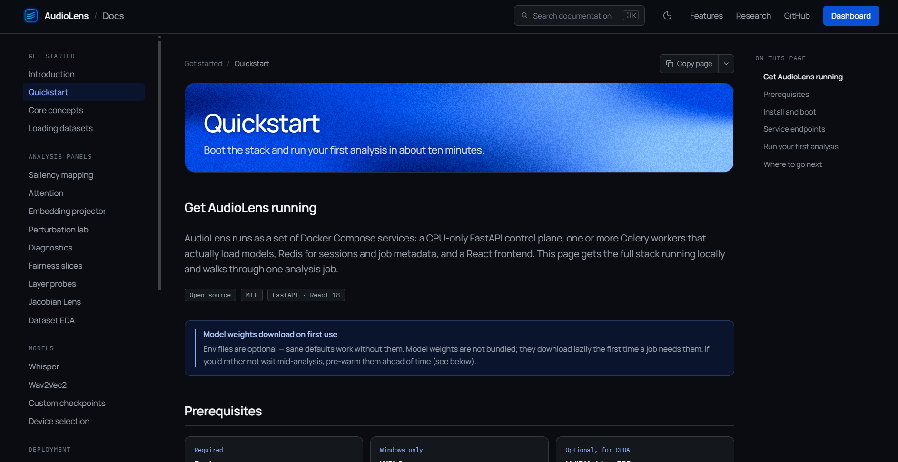

<div align="center">



---

# OpenDocera

**An open-source documentation site template for Next.js and MDX.**
Write pages in MDX, set your brand in one config file, or let an AI assistant do both.

[](LICENSE)
[](https://nextjs.org)
[](https://mdxjs.com)
[](https://nodejs.org)

[Quick start](#quick-start) · [Built with OpenDocera](#built-with-opendocera) · [Set it up with AI](#set-it-up-with-ai) · [Configuration](#configuration) · [Deploy](#deploy)

</div>

---

<p align="center">
  
  
</p>
<p align="center"><sub>The default template in light and dark mode.</sub></p>

## Overview

OpenDocera is a complete documentation site you can copy and make your own. It
includes sidebar navigation, full-text search, an "On this page" table of
contents, light and dark themes, and a grain-gradient page header. None of it
needs to be touched to get started.

Two places hold everything you customize:

| What | Where |
|---|---|
| Pages | `content/docs/*.mdx`, one file per page |
| Name, logo, links, colors, gradient | `docs.config.ts` |

The sidebar, search index, table of contents, sitemap and `/llms.txt` are all
generated from your MDX files. There is no page list to maintain by hand.

The pages shipped in `content/docs/` describe a fictional product called
**Acme**. They are placeholders that demonstrate every building block and are
meant to be replaced.

## Features

- **MDX pages with frontmatter.** Title, description, sidebar group, order, tag and draft status. Invalid frontmatter fails the build with the file name and the problem.
- **Search.** A ⌘K / Ctrl+K command palette over page titles, headings and body text, built at compile time with no external service.
- **Table of contents.** Generated from `##` headings, with scroll-spy highlighting.
- **Theming from four colors.** Every accent in light and dark mode is derived from one palette with `color-mix()`. Warnings stay yellow whatever the palette.
- **Page-header gradient.** A dependency-free WebGL grain gradient with an optional cloud layer, configured in the same file, with a CSS fallback.
- **Components with no imports.** Callouts, steps, cards, code tabs, badges and status labels, plus titled code blocks with syntax highlighting and a copy button.
- **Page actions.** Copy any page as Markdown, or open it in ChatGPT, Claude or Gemini.
- **Built for AI assistants.** An `AGENTS.md` guide, Claude Code skills, and `/llms.txt` and `/llms-full.txt` routes.
- **Static and SEO-ready.** Every page is prerendered, with canonical URLs, Open Graph tags, a sitemap and robots.txt.

## Built with OpenDocera

### AudioLens

[**audiolens-xi.vercel.app/docs**](https://audiolens-xi.vercel.app/docs/intro)

AudioLens is an interpretability and debugging workbench for speech models. Its
documentation runs on OpenDocera, with its own palette, logo and gradient, all
set in `docs.config.ts`.

[](https://audiolens-xi.vercel.app/docs/intro)

Using OpenDocera for your project? Open a pull request to add it here.

## Quick start

Requires Node.js 20.9 or later.

### Create a new site (recommended)

```bash
npm create opendocera@latest my-docs
```

The CLI asks for your product name, brand color and whether to keep the
sample pages. It writes `docs.config.ts`, derives the full palette from your
color, installs dependencies and initializes git. Then:

```bash
cd my-docs
npm run dev
```

Open [http://localhost:3000](http://localhost:3000).

pnpm, Yarn and Bun work too: `pnpm create opendocera`, `yarn create opendocera`,
`bun create opendocera`.

### Other ways to start

| Method | Command or action |
|---|---|
| GitHub template | Click **Use this template** on [the repository](https://github.com/Jaybro-git/open-docera) |
| create-next-app | `npx create-next-app@latest my-docs --example https://github.com/Jaybro-git/open-docera` |
| Plain download | `npx giget@latest gh:Jaybro-git/open-docera my-docs` |
| Deploy first | Use the button below to clone into your GitHub and deploy on Vercel |

[](https://vercel.com/new/clone?repository-url=https%3A%2F%2Fgithub.com%2FJaybro-git%2Fopen-docera&project-name=my-docs&repository-name=my-docs)

These copy the template as-is, so run `npm install` and edit `docs.config.ts`
yourself. If you used **Use this template**, also delete the `.github/` folder:
it holds this repository's CODEOWNERS file and README screenshots.

## Set it up with AI

The repository includes instructions that AI coding assistants pick up
automatically:

| File | Purpose |
|---|---|
| `AGENTS.md` | Page format, components, configuration and commands. Read by Claude Code, Codex, Cursor, Copilot and other agents. |
| `.claude/skills/import-docs` | Turns a README, a Markdown folder, a wiki export or a codebase into pages |
| `.claude/skills/add-page` | Writes a new page in the right group and verifies it builds |
| `.claude/skills/rebrand` | Sets the name, logo, links, colors and gradient |

Example prompts:

```text
Make docs for this project from my README and the src/ folder.
```

```text
Rebrand the site for Nimbus. The logo is nimbus.svg and the brand color is #2F6FED.
```

```text
Add a page under Guides explaining how to deploy to Vercel.
```

## Set it up by hand

### Add a page

Create `content/docs/my-page.mdx`:

```mdx
---
title: My page
description: One sentence shown under the title.
group: Guides
order: 4
---

## First section

Content starts at `##`. The page heading comes from `title`.
```

The file name becomes the URL (`/docs/my-page`). The page appears in the
sidebar, search and table of contents on the next `npm run dev` or
`npm run build`.

| Frontmatter key | Required | Meaning |
|---|---|---|
| `title` | yes | Sidebar label and page heading |
| `description` | yes | Line under the heading; also the search and SEO summary |
| `group` | yes | Sidebar group, matching a label in `docsConfig.groups` |
| `order` | no | Position inside the group, lower first |
| `tag` | no | Small chip after the sidebar label, such as `new` or `beta` |
| `draft` | no | `true` hides the page everywhere |

### Components

Available in every MDX file without imports. The `/docs/components` page shows
each one rendered.

| Component | Use |
|---|---|
| `<Lead>` | Larger opening paragraph |
| `<Badges>` | Small chips for version, license or stack |
| `<Callout>` | Boxed note, with `tone="note"` or `tone="warn"` |
| `<Steps>` / `<Step>` | Numbered procedure |
| `<CardGrid>` / `<Card>` | Grid of cards, linked when given `href` |
| `<CodeTabs>` | Several code blocks under tabs |
| `<Status>` | Muted status text for tables |

## Configuration

All branding lives in `docs.config.ts`:

| Setting | Controls |
|---|---|
| `name`, `title`, `description` | Header name, page titles, SEO and `/llms.txt` summary |
| `logo` | Square image in `public/`, shown at 28×28 |
| `links`, `cta` | Header links and the accent button (`cta: null` hides it) |
| `footer` | Text strip under every page |
| `groups` | Sidebar group order |
| `theme.palette` | Four colors that every accent is derived from |
| `theme.grainient` | Gradient behind page titles, with optional clouds and a dark-mode override |

The default palette is a warm terracotta:

```ts
palette: {
  deep: "#3A2116",    // darkest shade: hover text, callout titles
  brand: "#B4512F",   // main accent: buttons, links on white
  bright: "#D97757",  // lighter accent: links in dark mode
  neutral: "#8A7A68", // muted companion: soft background washes
}
```

`brand` needs at least 4.5:1 contrast against white, and `bright` needs to stay
readable on the dark background.

## Commands

| Command | Description |
|---|---|
| `npm run dev` | Regenerate the index and start the dev server |
| `npm run build` | Production build. Fails with a clear message on invalid frontmatter |
| `npm run start` | Serve the production build |
| `npm run docs:index` | Regenerate the sidebar, search and TOC index only |
| `npm run lint` | Run ESLint |

## Deploy

OpenDocera runs on any host that supports Next.js. On Vercel, import the
repository and deploy; no settings are required.

For a custom domain, set `NEXT_PUBLIC_SITE_URL` (for example
`https://docs.example.com`) so canonical URLs, the sitemap and `/llms.txt` use
it.

## Project structure

```text
content/docs/          your pages (.mdx)
docs.config.ts         name, logo, links, colors, gradient
public/                logo and images
app/docs/              docs shell: header, sidebar, search, TOC, page route
app/docs/components/   page actions, footer and MDX components
app/globals.css        design tokens derived from the palette
components/            theme toggle, grain gradient and UI primitives
scripts/               builds the sidebar, search and TOC index from MDX
```

## Tech stack

[Next.js 16](https://nextjs.org) (App Router, Turbopack) ·
[MDX](https://mdxjs.com) · [Tailwind CSS 4](https://tailwindcss.com) ·
[Shiki](https://shiki.style) via rehype-pretty-code ·
[cmdk](https://cmdk.paco.me) · [Base UI](https://base-ui.com)

## License

[MIT](LICENSE) © OpenDocera contributors
